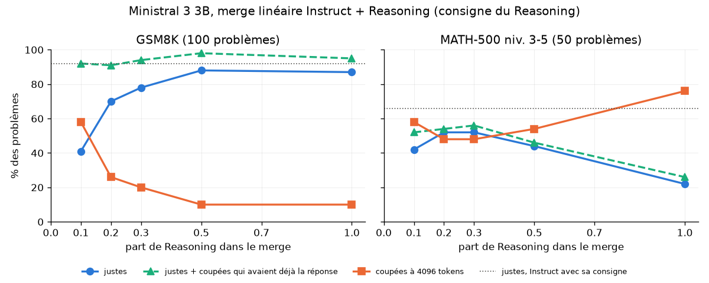

# Ministral 3 3B : merge de l'Instruct et du Reasoning

Mistral publie Ministral 3 3B en trois versions : **Base**, **Instruct**, qui
répond directement, et **Reasoning**, qui réfléchit d'abord dans des balises
`[THINK]…[/THINK]`. Question : un merge de l'Instruct et du Reasoning
donne-t-il un modèle qui « réfléchit un peu », plus juste que l'Instruct et
plus court que le Reasoning ? Et que se passe-t-il quand on fait varier la
part de Reasoning ?

**Réponse : aucun merge ne bat l'Instruct utilisé avec sa propre consigne**
(92 % sur GSM8K, 66 % sur MATH). Quatre dosages linéaires (10 à 50 % de
Reasoning) et un DARE-TIES restent à 2 à 6 problèmes sur 150 derrière lui,
avec des réponses MATH 14 à 35 % plus courtes. Aucun modèle n'est publié.

Ce que l'étude montre :

- **Quand on lui demande de réfléchir, même l'Instruct ouvre `[THINK]`, mais
  il ne sait pas le refermer.** Il trouve la bonne réponse, puis doute jusqu'à
  la limite de tokens. C'est la consigne qui fait réfléchir ; les poids du
  Reasoning apprennent surtout à conclure, et il en faut 30 à 50 % pour que le
  merge conclue aussi souvent que le Reasoning.
- **Quand un modèle conclut, il a presque toujours raison.** Les écarts de
  justesse viennent presque tous des réponses coupées, pas d'erreurs de
  calcul.
- Avec la consigne du Reasoning, le merge à 50 % égale le Reasoning sur GSM8K
  (88 % contre 87 %) avec 40 % de tokens en moins, et double son score sur
  MATH (44 % contre 22 %), parce que la limite de 4096 tokens coupe le
  Reasoning plus souvent.

## Fichiers

| Fichier | Rôle |
|---|---|
| `config-linear-r01.yaml` … `r05.yaml` | merges linéaires à 10, 20, 30 et 50 % de Reasoning |
| `config-dare-ties.yaml` | DARE-TIES sur la Base, 0,7 Instruct / 0,3 Reasoning |
| `fusionner.sh` | merge (CPU, graine 0) puis GGUF Q8_0, et supprime le merge HF (7 Go) |
| `convertir.sh` | conversion HF → GGUF Q8_0 avec llama.cpp |
| `creer.ps1` | import du GGUF dans Ollama sous `ministral-<nom>:q8_0` |
| `eval_justesse.py` | tire les questions, interroge Ollama, écrit `resultats.md` |
| `analyser.py` | analyse des réponses coupées, écrit `analyse.md` et `courbe.png` |
| `angles.py` | angles entre les changements de l'Instruct et du Reasoning |
| `questions/`, `reponses/` | questions tirées et réponses brutes de chaque modèle |

Modèles : `mistralai/Ministral-3-3B-Instruct-2512-BF16` (le dépôt sans `-BF16`
est en FP8), `mistralai/Ministral-3-3B-Reasoning-2512` et
`mistralai/Ministral-3-3B-Base-2512`, tous en Apache 2.0. mergekit 0.1.5
connaît l'architecture `Mistral3ForConditionalGeneration` (texte, vision et
projecteur : les 458 tenseurs sont fusionnés).

Lancement (dans WSL, environnement activé ; Ollama tourne sous Windows) :

```bash
bash 08-ministral/fusionner.sh linear-r05            # environ 8 min de merge, puis GGUF
powershell.exe -File 08-ministral/creer.ps1 linear-r05
python 08-ministral/eval_justesse.py preparer
python 08-ministral/eval_justesse.py evaluer ministral-linear-r05:q8_0 --nom linear-r05
python 08-ministral/eval_justesse.py evaluer ministral-linear-r05:q8_0 \
    --nom linear-r05-consigne-instruct --consigne instruct
python 08-ministral/eval_justesse.py synthese
python 08-ministral/analyser.py
python 08-ministral/angles.py
```

## Protocole

- **Questions** : 100 problèmes de GSM8K (test) et 50 de MATH-500 de niveaux 3
  à 5, tirés une fois pour toutes avec la graine 0.
- **Génération** : GGUF Q8_0 dans Ollama, sur la RTX 4060 (environ 60 tokens/s).
  Température 0,7, top_p 0,95, graine 0, les réglages de la fiche du
  Reasoning : en décodage glouton, les modèles qui réfléchissent tournent en
  boucle. Au plus 4096 tokens par réponse.
- **Consigne** : deux séries. Avec la consigne du Reasoning (« réfléchis dans
  [THINK], puis réponds »), on mesure ce que fait chaque modèle quand on lui
  demande de réfléchir. Avec celle de l'Instruct (noms en
  `-consigne-instruct`), on le compare à l'Instruct dans son usage normal.
- **Notation** : une réponse est juste si elle n'est pas coupée et si son
  dernier `\boxed{}` (pour GSM8K, à défaut, son dernier nombre) vaut la
  réponse attendue selon math-verify. Une réponse coupée compte comme fausse :
  l'utilisateur n'a rien reçu.
- **[THINK]** : Ollama retire les tokens spéciaux du texte. On les compte
  quand même : tokens générés moins tokens renvoyés. Une réponse finie
  normalement en cache 3 (`[THINK]`, `[/THINK]`, fin de texte) ; une réponse
  coupée qui n'en cache qu'un était encore en réflexion. L'Instruct et le
  merge à 20 % écrivent souvent les balises en texte ordinaire au lieu du
  token spécial : on compte aussi `[THINK]` et `[/THINK]` écrits en clair.

## Résultats avec la consigne de l'Instruct

C'est la comparaison qui décide s'il y a un modèle à publier : chaque merge
contre l'Instruct, dans l'usage normal de l'Instruct.

| Modèle | GSM8K (100) | MATH (50) | Total | Tokens MATH (médiane) | Coupées MATH |
|---|---|---|---|---|---|
| **Instruct** | **92** | **33** | **125** | 1276 | 13 |
| linear-r02 (20 %) | **92** | 31 | 123 | 934 | 12 |
| linear-r03 (30 %) | 90 | 32 | 122 | 1094 | 13 |
| DARE-TIES (0,7 / 0,3) | 90 | 31 | 121 | **824** | 12 |
| linear-r05 (50 %) | 87 | 32 | 119 | 1046 | 10 |

- Les écarts sont dans le bruit : chaque merge réussit 2 à 5 problèmes que
  l'Instruct rate, et en rate 3 à 8 que l'Instruct réussit. La seule tendance
  nette : sur GSM8K, plus il y a de Reasoning, plus le merge baisse.
- Avec cette consigne, les merges ne réfléchissent presque jamais sur GSM8K
  (1 à 5 % des réponses) et un peu sur MATH (16 à 20 %, contre 10 % pour
  l'Instruct). Leurs réponses MATH sont plus courtes, mais sont coupées aussi
  souvent.
- **DARE-TIES contre linéaire, au même dosage (r03)** : 90 contre 90 sur
  GSM8K, 31 contre 32 sur MATH. Changer de méthode ne change pas la justesse ;
  seule la longueur baisse encore (824 tokens contre 1094).

### Pourquoi DARE-TIES n'apporte rien ici

`angles.py` compare les changements de chaque modèle par rapport à la Base
(moyenne sur les matrices du texte) :

| Mesure | Valeur |
|---|---|
| cosinus entre (Instruct − Base) et (Reasoning − Base) | ≈ 0,5 |
| norme de (Instruct − Base) / (Reasoning − Base) / (Reasoning − Instruct) | ≈ 3,5 / 10,7 / 9,4 |
| poids dont les deux changements sont de signes opposés | 33 % (50 % au hasard) |

Les deux changements sont à moitié alignés : ni copies l'un de l'autre, ni
indépendants. Le Reasoning n'est pas un simple prolongement de l'Instruct (le
cosinus entre (Instruct − Base) et (Reasoning − Instruct), déduit des
moyennes ci-dessus, est d'environ 0,2 ; un prolongement indépendant donnerait
0) :
les deux partagent sans doute un début d'entraînement, puis le Reasoning a été
entraîné beaucoup plus loin (changement 3 fois plus grand, normes et
embeddings modifiés, que l'Instruct ne touche presque pas). Le poids 0,7 / 0,3
donne donc aux deux modèles une influence réelle comparable. Mais un tiers de
conflits, c'est peu : TIES a peu à trier, et DARE, qui ne garde qu'une partie
des changements, raccourcit les réponses sans changer leur justesse.

## Résultats avec la consigne du Reasoning

Détail dans [resultats.md](resultats.md) et [analyse.md](analyse.md).

| Modèle | Part de Reasoning | GSM8K | MATH | Tokens GSM8K (médiane) | Coupées GSM8K / MATH |
|---|---|---|---|---|---|
| Instruct | 0 | 40 % (52 questions, arrêté) | – | 4096 | 29 sur 52 / – |
| linear-r01 | 10 % | 41 % | 42 % | 4096 | 58 / 29 |
| linear-r02 | 20 % | 70 % | 52 % | 515 | 26 / 24 |
| linear-r03 | 30 % | 78 % | 52 % | 920 | 20 / 24 |
| linear-r05 | 50 % | **88 %** | 44 % | 880 | 10 / 27 |
| Reasoning | 100 % | 87 % | 22 % | 1416 | 10 / 38 |
| *Instruct, sa propre consigne* | *0* | *92 %* | *66 %* | *205* | *0 / 13* |



### Pourquoi les réponses sont coupées

`analyser.py` regarde les réponses arrêtées par la limite de 4096 tokens :

| Modèle | GSM8K coupées | encore dans `[THINK]` | contenaient déjà la bonne réponse |
|---|---|---|---|
| Instruct (52 questions) | 29 | 29 | 25 |
| linear-r01 | 58 | 48 | 51 |
| linear-r02 | 26 | 26 | 21 |
| linear-r03 | 20 | 17 | 16 |
| linear-r05 | 10 | 8 | 10 |
| Reasoning | 10 | 8 | 8 |

- **Ce ne sont pas des boucles mot pour mot.** Compressée avec zlib, la fin
  des réponses coupées garde 33 à 39 % de sa taille, comme un texte normal (une
  boucle descendrait vers 5 %). À température 0,7, le modèle reformule.
- **Ce sont des doutes sans fin.** À 10 % de Reasoning, 51 des 58 réponses
  coupées contenaient déjà la bonne réponse. Le modèle la vérifie, envisage
  une autre lecture de l'énoncé (« et si 150 % portait sur le prix des
  travaux ? »), revient à la première, recommence. En comptant ces réponses
  trouvées mais jamais rendues, r01 atteint 92 % sur GSM8K, autant que
  l'Instruct.
- **Le dosage.** La consigne suffit à faire réfléchir : l'Instruct seul ouvre
  `[THINK]` à chaque réponse (écrit en texte), et 25 de ses 29 réponses
  coupées avaient déjà la bonne réponse. Ce que les poids du Reasoning
  apportent, c'est la capacité à conclure et à fermer `[/THINK]` : sur
  GSM8K, les réponses coupées passent de 58 % (10 % de Reasoning) à 26 %
  (20 %), 20 % (30 %) puis 10 % (50 %, autant que le Reasoning). Sur MATH,
  plus difficile, un second effet s'y oppose : plus il y a de Reasoning, plus
  la réflexion est longue, et au-delà de 30 % les coupures remontent (54 % à
  50 %, 76 % pour le Reasoning). Le meilleur dosage pour MATH, sous 4096
  tokens, est donc entre 20 et 30 % (52 %).
- **Curiosité.** À 10 %, 30 % et 50 %, le merge utilise le token spécial
  `[THINK]`. À 20 %, comme l'Instruct, il l'écrit souvent en texte ordinaire.
  Je n'ai pas d'explication ; avec une seule graine, ce peut être du hasard
  d'échantillonnage sur le tout premier token.
- **Quand un merge conclut, il a presque toujours raison.** Réponses finies
  justes : r01 41/42 sur GSM8K et 21/21 sur MATH ; r02 70/74 et 26/26 ; r03
  78/80 et 26/26 ; r05 88/90 et 22/23 ; Reasoning 87/90 et 11/12 (Instruct
  avec sa consigne : 92/100 et 33/37). Les écarts de justesse entre modèles
  viennent donc presque tous de la part de réponses coupées.
- **MATH.** Le constat est le même mais se mesure moins bien : sans `\boxed`,
  une réponse LaTeX écrite en clair ne se vérifie pas automatiquement, donc la
  colonne « déjà trouvée » n'y compte que les `\boxed` justes. Le Reasoning y
  est coupé 38 fois sur 50 : 4096 tokens ne lui suffisent pas, et son 22 %
  mesure surtout cette limite.

Limite de la mesure « déjà trouvée » sur GSM8K : on cherche le nombre attendu
dans le texte, s'il n'est pas dans l'énoncé. Un résultat intermédiaire égal
par hasard à la réponse peut compter à tort.

## Limites

- Petit échantillon : 100 problèmes GSM8K et 50 MATH, une seule graine. Un
  écart de 2 ou 3 problèmes n'est pas significatif ; seules les grandes
  tendances (la courbe avec la consigne du Reasoning) sont solides.
- Limite de 4096 tokens : elle désavantage le Reasoning, qui a besoin de plus
  sur MATH. Avec 8192 tokens, son score serait sans doute nettement meilleur.
- GGUF Q8_0 plutôt que BF16 : sur Qwen 1.5B, la perte mesurée en Q8 était
  nulle (voir `06-gguf`).

## Conclusion

Avec sa propre consigne, l'Instruct reste le meilleur choix pour ces
problèmes ; aucun merge, linéaire ou DARE-TIES, ne le dépasse. Le merge à
50 % est un meilleur « modèle qui réfléchit » que le Reasoning quand le budget
de tokens est serré, mais l'échantillon est trop petit pour en faire un modèle
publié. Ce que l'étude apporte, c'est la dissociation entre réfléchir et
conclure : la consigne suffit pour le premier, le second s'apprend, et c'est
lui que transmettent les poids du Reasoning.
